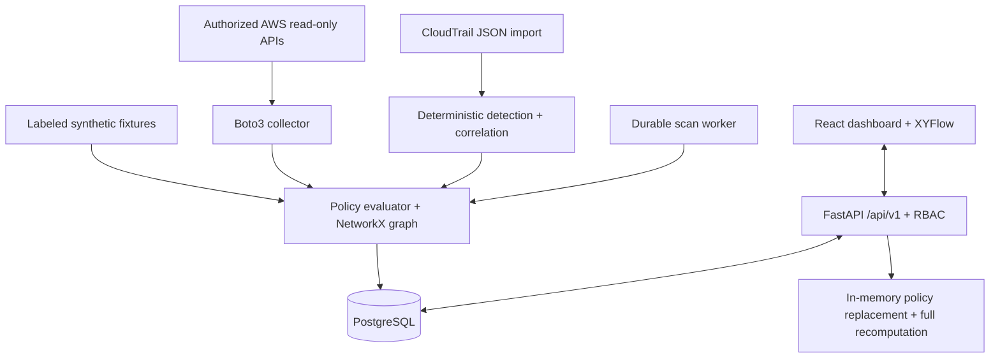

# Architecture

The monorepo separates frontend, backend and reproducible evaluation. PostgreSQL is authoritative; Alembic creates entity tables. Native source documents are stored in JSON alongside primary keys, scan provenance, timestamps and indexes. This schema favors inspectable AWS evidence over speculative normalization. It is not a complete enterprise CMDB schema.

The worker claims scans using PostgreSQL row locks, persists source snapshots and results, and reports partial visibility. A crash leaves a scan lease that expires visibly; it does not silently mark success. The API serves persisted inventory and analysis, analyst workflows, audit history and exports. Frontend requests never contain AWS secrets. Simulation alters a copy of a dataset and cannot call AWS write APIs.

Authentication uses salted scrypt password hashes and random one-hour bearer tokens stored only as hashes server-side. Roles are enforced at API boundaries. The deployment is single organization; there is no tenant isolation claim. Browser sessions use sessionStorage and require protection from XSS. Demo data is synthetic and labeled throughout the interface.
