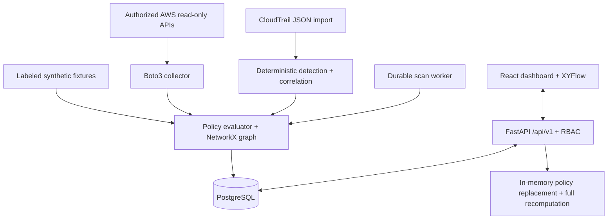

# CloudPathX

**Cloud Identity Attack Path Detection & Non-Human Identity Security Platform**

> **M.Tech CSE — Cyber Security Research Project**  
> Developer: Pratham Shah · VIT Vellore  
> Evidence-aware cloud identity attack path analysis and non-human identity security.

---

## Overview

CloudPathX is an enterprise-grade cloud security platform that detects identity-related attack paths and non-human identity risks inside AWS environments. It uses graph-based analysis enriched with CloudTrail behavioral evidence to prioritize which identities and permission chains represent the most credible risks.

**Key differentiator:** An interactive, evidence-backed Cloud Identity Attack Path Graph that traces how an attacker might chain together role assumptions, policy permissions, and resource access — and shows exactly what evidence supports each conclusion.

> **Scope:** CloudPathX performs passive read-only analysis. It never modifies AWS resources. All "attack paths" are potential paths derived from permission analysis, not confirmed exploitations.

---

## Architecture

```
AWS APIs (boto3, read-only)  →  Collector (aws.py)      ─┐
Demo synthetic fixtures      →  IAM Engine (engine.py)  ─┤→ PostgreSQL (Alembic)
CloudTrail JSON import       →  Detection rules          ─┘
                                                           ↕
               FastAPI /api/v1 (RBAC, CORS, rate limits) ←→ DB
               React dashboard (XYFlow, Recharts)        ←→ API
               Remediation simulator (in-memory reanalysis, no AWS writes)
```



---

## Features

| Feature | Status |
|---|---|
| IAM policy analyzer (Allow/Deny/Conditions/NotAction) | ✅ |
| Trust relationship analysis | ✅ |
| Permissions boundary + session policy evaluation | ✅ |
| SCP/RCP layer modelling (documented subset) | ✅ |
| NetworkX-based attack path graph | ✅ |
| Three-hop role chain detection | ✅ |
| Cross-account trust detection | ✅ |
| Non-human identity inventory | ✅ |
| CloudTrail event ingestion + rule matching | ✅ |
| MITRE ATT&CK technique mapping | ✅ |
| Evidence-aware risk scoring (0–100, reproducible) | ✅ |
| Remediation simulator (what-if, no AWS changes) | ✅ |
| PDF + JSON security reports | ✅ |
| Investigation management with audit trail | ✅ |
| RBAC (Administrator / Security Analyst / Viewer) | ✅ |
| scrypt password hashing + one-hour bearer tokens | ✅ |
| Offline demo mode (9 synthetic scenarios) | ✅ |
| Docker Compose single-command setup | ✅ |
| GitHub Actions CI (lint, type check, tests, secret scan) | ✅ |

---

## Technology Stack

**Frontend:** React 19 · TypeScript · Vite · Tailwind CSS v4 · shadcn/ui · XYFlow · Recharts · TanStack Query  
**Backend:** Python 3.12 · FastAPI · Pydantic v2 · SQLAlchemy · Alembic · PostgreSQL · Boto3 · NetworkX  
**Security:** AWS IAM · STS · Access Analyzer · CloudTrail · S3 config APIs  
**DevOps:** Docker · Docker Compose · GitHub Actions · pytest · Playwright · Ruff · mypy

---

## Quick Start (Offline Demo — No AWS Required)

### Prerequisites
- Docker Desktop (running)
- Git
- `make` (macOS: `xcode-select --install`)

### 1. Clone and setup
```bash
git clone https://github.com/PrathamShah1210/CloudPathX.git
cd CloudPathX
make setup        # generates a random local DB password
```

### 2. Start all services
```bash
make dev          # runs docker compose up --build -d
```

Wait ~60 seconds for all containers to become healthy.

### 3. Create an administrator account
```bash
make bootstrap EMAIL=admin@example.com
# Enter a password ≥ 12 characters when prompted
# Or: CLOUDPATHX_ADMIN_PASSWORD=mypassword make bootstrap EMAIL=admin@example.com
```

### 4. Load the synthetic demo
```bash
make demo         # queues a synthetic scan; the worker processes it automatically
```

### 5. Open the dashboard
```
http://localhost:5173
```

Sign in with the email and password you bootstrapped.

---

## Running Tests

```bash
# Backend unit + integration tests (51 tests, 99% coverage)
make test

# Or individually:
cd backend && .venv/bin/python -m pytest -q --cov=app.engine

# Frontend type check + Playwright E2E (5 tests)
cd frontend && npm run lint && npm test
```

---

## AWS Live Mode

> **Never enter AWS access keys into the UI.** The backend uses the SDK credential chain.

1. Configure an AWS profile with the read-only policy in `docs/aws-read-only-policy.json`
2. In the dashboard, go to **Integrations → Connect account**
3. Enter the AWS account ID, profile name (or a role ARN to assume), and region
4. Click **Scan** — the backend will collect IAM data using boto3

The live scan shares the same analysis engine as the demo.

---

## Offline Demo Scenarios

All nine scenarios are processed through the real IAM analyzer and graph engine — not hardcoded UI values:

| # | Scenario | What It Shows |
|---|---|---|
| 1 | Overprivileged service role (`payments-worker`, `Action: *`) | High-risk broad permission finding |
| 2 | Cross-account trust (`vendor-bridge` → external account `999900001111`) | External principal finding |
| 3 | Three-hop role chain (`developer → deployment → payments-worker`) | Multi-step attack path |
| 4 | Sensitive S3 access (`cloudpathx-demo-finance`) | Resource exposure finding |
| 5 | IAM policy change signal (`PutRolePolicy` CloudTrail event) | Behavioral detection alert |
| 6 | Excessive machine permissions (wildcard on service role) | Non-human identity risk |
| 7 | Access denial correlation (3× AccessDenied events) | Correlated behavioral signal |
| 8 | Remediation removes paths (restrict `payments-worker` policy) | 3 of 4 paths eliminated |
| 9 | Benign secure role (`metrics-reader`, CloudWatch only) | True negative — no finding |

---

## Research Contribution

**Evidence-Aware Graph-Based Cloud Identity Attack Path Prioritization**

The project compares three detection approaches on the same synthetic dataset:

| Method | Precision | Recall | nDCG |
|---|---|---|---|
| Independent configuration rules | 1.0 | 0.5 | 0.777 |
| Graph-based path analysis | 1.0 | 1.0 | 0.734 |
| Graph + CloudTrail behavioral evidence | 1.0 | 1.0 | **0.973** |

Graph-based analysis recovers the full set of at-risk identities (recall = 1.0 vs 0.5). Adding behavioral evidence significantly improves risk prioritization ranking (nDCG 0.734 → 0.973).

> **Limitations:** These metrics are on a constructed five-identity demonstration dataset. The behavior labels intentionally align with inserted signals. No statistical generalization is claimed.

Full methodology: [`EVALUATION.md`](EVALUATION.md) · [`RESEARCH.md`](RESEARCH.md)

---

## Project Structure

```
CloudPathX/
├── backend/
│   ├── app/
│   │   ├── main.py       # FastAPI app, all 40+ endpoints, RBAC
│   │   ├── engine.py     # IAM evaluator + NetworkX graph + risk scoring (768 lines)
│   │   ├── aws.py        # Boto3 read-only collector (159 lines)
│   │   ├── db.py         # SQLAlchemy models, 21 entity tables
│   │   ├── store.py      # PostgreSQL persistence helpers
│   │   ├── security.py   # scrypt hashing, bearer tokens, role checks
│   │   ├── worker.py     # Durable background scan worker
│   │   └── cli.py        # bootstrap / demo admin CLI
│   ├── alembic/          # Database migrations
│   └── tests/            # 51 pytest tests (99% engine coverage)
├── frontend/
│   ├── src/
│   │   ├── App.tsx        # Complete React app (12 pages, all functional)
│   │   ├── api.ts         # API client with auth
│   │   └── styles.css     # Professional UI styles
│   └── tests/
│       └── workspace.spec.ts  # 5 Playwright E2E tests
├── scripts/
│   ├── evaluate.py        # Reproducible research evaluation
│   └── setup.py          # Local credential generator
├── docs/
│   ├── aws-read-only-policy.json
│   └── evaluation-results.json
├── .github/workflows/ci.yml  # Full CI pipeline
├── compose.yaml           # Docker Compose (5 services)
├── Makefile               # dev / test / demo / lint / down
└── [14 documentation files]
```

---

## Make Commands

```bash
make setup    # Generate local .env with random DB password
make dev      # docker compose up --build -d
make bootstrap EMAIL=admin@example.com  # Create admin user
make demo     # Queue synthetic demo scan
make test     # Run backend pytest + frontend Playwright
make lint     # Ruff + mypy + tsc
make down     # docker compose down
```

---

## Security Design

- **No hardcoded credentials** — `.env` is gitignored; passwords never logged
- **scrypt password hashing** — salted, not MD5 or bcrypt
- **Bearer tokens** — random UUID, stored only as SHA-256 hashes server-side; expire after 1 hour
- **RBAC enforced at every API endpoint** — not just UI
- **Read-only AWS** — no write APIs called; never accepts root credentials
- **Content-Security headers** — X-Content-Type-Options, X-Frame-Options, Referrer-Policy, Cache-Control: no-store
- **Body size limit** — 5 MB request cap
- **Login rate limiting** — brute-force protection
- **Secret scanning in CI** — gitleaks on every push

---

## Documented Limitations

1. IAM evaluation covers a documented subset — SCPs/RCPs/resource policies/session policies are modelled but incomplete
2. Demo data is synthetic and labeled throughout the UI
3. "Potential attack paths" are derived from permission analysis — not confirmed exploitation
4. Live mode requires an authorized read-only AWS profile (not tested in automated CI)
5. Single-organization deployment — no multi-tenant isolation
6. Scalability measured on small graphs — dense adversarial environments untested

Full details: [`IAM_ANALYSIS.md`](IAM_ANALYSIS.md) · [`THREAT_MODEL.md`](THREAT_MODEL.md)

---

## CI/CD

GitHub Actions runs on every push and pull request:

- **backend** — ruff lint · mypy · pytest (85%+ coverage gate) · pip-audit
- **frontend** — tsc · vite build · Playwright E2E · npm audit
- **secrets** — gitleaks history scan
- **containers** — full docker compose up --wait health check

---

## License

Research project — VIT Vellore M.Tech CSE Cyber Security Program.  
Not licensed for commercial use.
