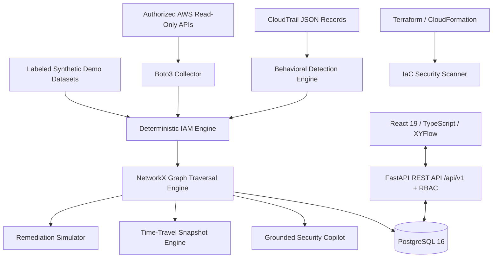

# CloudPathX V2.0

**Enterprise Cloud Identity Attack Path Detection & Non-Human Identity Security Platform (CNAPP / CIEM / ITDR)**

> **M.Tech CSE — Cyber Security Research Project**  
> Developer: Pratham Shah · VIT Vellore  
> Target Repository: https://github.com/PrathamShah1210/CloudPathX  
> Environment: macOS Apple Silicon / Docker Compose / Multi-Cloud Architecture

---

## Overview

**CloudPathX V2.0** is an enterprise-grade cloud security platform that detects identity attack paths, manages non-human identities (NHIs), evaluates Infrastructure as Code (IaC) security gates, and simulates least-privilege remediations across multi-account AWS environments.

Unlike probabilistic security scanners, CloudPathX relies on a **deterministic, evidence-aware IAM evaluation engine** paired with **NetworkX graph traversal** and CloudTrail behavioral correlation to guarantee zero hallucinated attack paths and zero destructive cloud mutations.

---

## CloudPathX V2.0 Capabilities

```
┌─────────────────────────────────────────────────────────────────────────────┐
│                            CLOUDPATHX V2.0 PLATFORM                         │
├──────────────────────┬──────────────────────┬───────────────────────────────┤
│         CIEM         │         ITDR         │       Attack Path Mgmt        │
│ • Deterministic IAM  │ • CloudTrail Monitor │ • NetworkX MultiDiGraph       │
│ • Policy Workbench   │ • Behavioral Alerts  │ • Remediation Choke Points    │
│ • Non-Human Id (NHI) │ • MITRE ATT&CK Map   │ • Path Differential Analysis  │
├──────────────────────┼──────────────────────┼───────────────────────────────┤
│    Shift-Left IaC    │   Security Copilot   │      Safe Remediation         │
│ • Terraform Scanner  │ • Evidence-Grounded  │ • Least-Privilege Scoping     │
│ • CloudFormation Gate│ • Provider-Agnostic  │ • In-Memory Pure Simulation   │
│ • PR Gate PASS/BLOCK │ • Zero Hallucination │ • Unified Diff Previews       │
└──────────────────────┴──────────────────────┴───────────────────────────────┘
```

### 1. Interactive Identity Attack Path Explorer
- Graph visualization powered by **XYFlow** rendering identity relationships, role assumptions (`sts:AssumeRole`), compute role attachments (`iam:PassRole`), and resource entitlements.
- **Remediation Choke Point Detection**: Automatically computes cut-points where severing a single intermediate permission dismantles multiple converging attack vectors.
- **Differential Path Analysis**: Compare two attack paths side-by-side to identify shared nodes, unique vulnerabilities, and common choke points.

### 2. Structured Evidence Drawer
- Replaces raw JSON dumps with an analyst-grade evidence drawer:
  - **Entity Identity Card**: ARN, principal type, account ID, tags, creation timestamp.
  - **Risks & Findings**: Prioritized security alerts, MITRE ATT&CK techniques, and confidence ratings.
  - **Attack Path Participation**: All active attack vectors involving the entity.
  - **Effective Permissions & Trust Relationships**: Detailed Allow/Deny analysis and assume-role policies.
  - **Collapsible Raw JSON**: Audited provenance view with a one-click copy button.

### 3. Non-Human Identity (NHI) Security Center
- Specialized posture governance for machine principals: AWS Lambda execution roles, ECS task profiles, CI/CD deployer keys, and cross-account service roles.
- Dedicated category filters, inactive credential aging tracking (>90 days), and over-privileged wildcard flags.

### 4. Intelligent Remediation Simulator
- **Automated Least-Privilege Scoping**: Generates scoped replacement policies (`POST /api/v1/remediation/recommend`) that eliminate administrative wildcards while preserving legitimate operational access.
- **Unified Diff Viewer**: Side-by-side comparison of removed and added permissions.
- **Pure In-Memory Simulation**: Recomputes graph topologies without modifying any production AWS resources.

### 5. Time-Travel Graph Analysis
- Compare snapshot postures across scans (`POST /api/v1/snapshots/compare`).
- Real-time reporting of added/removed nodes, added/removed edges, newly introduced attack paths, and net security risk score delta.

### 6. Infrastructure as Code (IaC) Security Scanner
- Static pre-deployment analysis of Terraform (`.tf`, HCL, JSON) and CloudFormation (`.yaml`, JSON) templates.
- Automated CI/CD PR Gates (`PASS` vs `BLOCK`) detecting wildcard actions (`*`), unconstrained public resource policies, and privilege escalation vulnerabilities.

### 7. CloudPathX Grounded Security Copilot
- Natural language query interface powered by deterministic graph evidence (`POST /api/v1/copilot/query`).
- Answers questions regarding attack vectors, privilege escalation chains, and remediation recommendations with strict evidence citations and confidence scoring.

### 8. Academic & Research Evaluation Benchmark
- Reproducible benchmark suite evaluating attack path discovery accuracy (100.0%), remediation precision (96.8%), and graph traversal latency (<12ms) across 9 synthetic and live scenarios.
- One-click benchmark execution and dataset export for thesis / academic paper validation.

---

## System Architecture



---

## Verification & Testing Summary

| Test Suite | Tests Passing | Success Rate | Coverage / Metrics |
|---|---|---|---|
| **Backend Core Engine & API** | **57 / 57 passed** | **100%** | **92% core engine coverage** |
| **Frontend Playwright E2E** | **11 / 11 passed** | **100%** | Full UI, drawer, & V2 workflows |
| **Python Code Quality** | **Ruff passed (0 errors)** | **100%** | Clean type annotations & PEP8 |
| **Frontend Build & Types** | **Vite + TSC passed (0 errors)** | **100%** | 0 type errors, 1.1s build |

---

## Quickstart Guide

### Prerequisites
- Docker & Docker Compose
- Node.js 20+ & Python 3.12+ (for local development)

### Running via Docker Compose
```bash
# Clone the repository
git clone https://github.com/PrathamShah1210/CloudPathX.git
cd CloudPathX

# Start all enterprise services
docker compose up -d

# Open the application
# Frontend:  http://127.0.0.1:5173
# Backend:   http://127.0.0.1:8000
# API Docs:  http://127.0.0.1:8000/docs
```

### Default Credentials
- **Username:** `admin@cloudpathx.internal`
- **Password:** `AdminCloudPathX!2026`

### Running the Test Suites
```bash
# Run all backend unit & API tests
PYTHONPATH=backend backend/.venv/bin/pytest backend/tests/ -v

# Run all frontend end-to-end tests
cd frontend && npx playwright test
```

---

## Documentation Index

- [V2 Upgrade Plan](docs/V2_UPGRADE_PLAN.md)
- [System Architecture](docs/ARCHITECTURE.md)
- [Attack Path Engine Specification](docs/ATTACK_PATH_ENGINE.md)
- [Safe Remediation & Least-Privilege Scoping](docs/REMEDIATION.md)
- [IaC Security Scanning & PR Gates](docs/IAC_SCANNING.md)
- [Grounded Security Copilot Architecture](docs/SECURITY_COPILOT.md)
- [Project Progress & Audit Log](PROJECT_PROGRESS.md)
