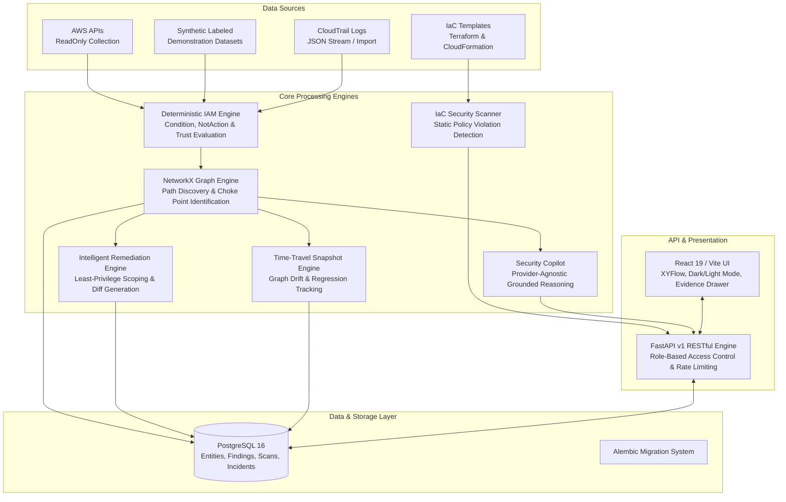

# CloudPathX V2.0 — System Architecture

**Cloud Identity Attack Path Detection & Non-Human Identity Security Platform**  
*M.Tech CSE (Cyber Security) — VIT Vellore*  
*Developer: Pratham Shah*

---

## 1. Executive Architecture Summary

CloudPathX V2.0 is an enterprise Cloud-Native Application Protection Platform (CNAPP) specializing in Cloud Infrastructure Entitlement Management (CIEM), Identity Threat Detection and Response (ITDR), Attack Path Management, and Non-Human Identity (NHI) Security.

The core philosophy of CloudPathX is **evidence-grounded determinism**:
- Zero assumptions treated as facts.
- No destructive or mutating actions against cloud environments.
- Continuous graph-based path traversal across complex privilege escalation chains.
- Strict isolation between analysis models and production infrastructure.

---

## 2. Core Subsystems

### 2.1 Deterministic IAM Policy Evaluation Engine (`backend/app/engine.py`)
- Evaluates statements strictly following AWS IAM evaluation semantics:
  1. Explicit Deny overrides all.
  2. Boundaries and Service Control Policies (SCPs) restrict the maximum allowable privileges.
  3. Allow statements must explicitly match actions, resources, and condition keys.
  4. Unsupported or absent condition keys are recorded as `uncertain` assumptions rather than evaluated as open permits.
- Supports comprehensive condition operators (`StringEquals`, `StringLike`, `ArnEquals`, `IpAddress`, `NumericLessThan`, `DateGreaterThan`, `Bool`, etc.).

### 2.2 NetworkX Attack Path Graph Traversal
- Represents cloud estates as a directed multigraph $G = (V, E)$:
  - Vertices $V$: IAM Principals (Users, Roles, Service Accounts), Resources (S3, SecretsManager, RDS, KMS), and External Accounts.
  - Edges $E$: Direct entitlements (`MAY_ACCESS`), Privilege Escalation vectors (`CAN_ASSUME_ROLE`, `PASS_ROLE`), and Trust Delegations (`TRUSTS_PRINCIPAL`).
- Traversal algorithm computes all paths from external/untrusted entry points to crown jewel target assets.
- Automatically calculates the **cut-point (remediation choke point)**: the critical intermediate node or relationship whose severance breaks the maximum number of attack paths.

### 2.3 Intelligent Remediation Simulator
- Proposes precise least-privilege scoping policies for over-privileged identities.
- Generates structured and unified diffs showing removed wildcard actions (`diff-del`) and retained operational permissions.
- Simulates policy changes purely in-memory by cloning the graph, applying the replacement policy, and re-running path traversal, computing the exact drop in risk score and dismantled paths without touching AWS.

### 2.4 Time-Travel Graph Analysis
- Captures immutable snapshots of security states across scans.
- Computes structural delta between two points in time:
  - $\Delta V$: Added and removed principals/assets.
  - $\Delta E$: Added and removed trust relationships.
  - $\Delta P$: Newly introduced vs remediated attack paths.
  - Net risk score delta tracking posture regression or improvement.

### 2.5 Shift-Left IaC Security Scanner
- Static AST and lexical analysis for Terraform (HCL/JSON) and CloudFormation (YAML/JSON) templates.
- Enforces CI/CD PR Gates: blocks pull requests containing wildcard actions (`*`), unconstrained public resource policies (`Principal: *`), or dangerous privilege escalation permissions (`iam:PassRole`, `iam:PutUserPolicy`).

### 2.6 Grounded Security Copilot (`backend/app/copilot.py`)
- Provider-agnostic natural language reasoning engine.
- Every response is strictly linked to verified IAM statement evidence, active graph paths, and detected findings.
- Zero-hallucination guardrails: if an answer is not established in the evidence graph, Copilot explicitly flags uncertainty.

---

## 3. Threat Model & Security Guarantees

| Concern | Guarantee |
|---|---|
| **AWS Mutation Risk** | **Zero Mutation**: Read-only collection uses read-only STS/IAM APIs. Remediation is simulated purely in memory. |
| **Credential Safety** | Never asks for or stores AWS Access Secret Keys. Relies on the default AWS SDK credential chain or assume-role. |
| **Data Isolation** | Strict Multi-Tenant or Workspace isolation with PostgreSQL foreign keys and server-side RBAC. |
| **Integrity & Provenance** | Every finding links back to specific statement index, condition evaluation, and CloudTrail event ID. |
