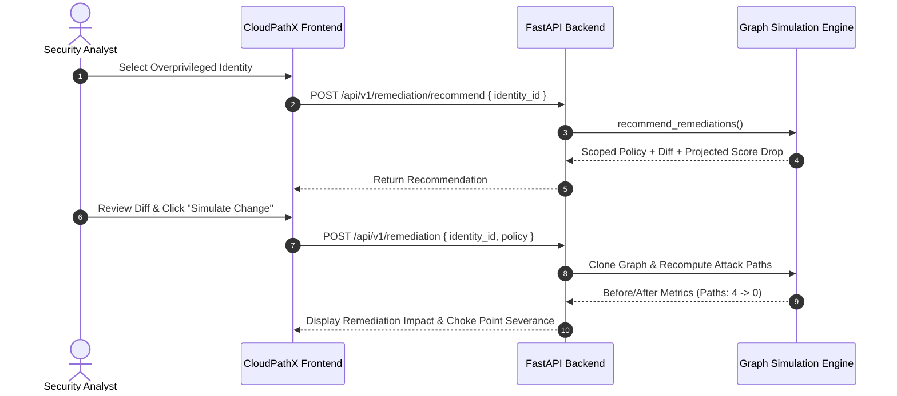

# CloudPathX — Remediation & Least-Privilege Scoping

**Module:** `backend/app/engine.py`  
**Endpoint:** `POST /api/v1/remediation/recommend` & `POST /api/v1/remediation`  
**Version:** 2.0

---

## 1. Principles of Safe Cloud Remediation

Traditional cloud security tools often break production workloads by blindly revoking permissions or deleting policies directly in the customer environment.

CloudPathX implements **Deterministic In-Memory Simulation**:
1. **Zero Cloud Mutation Guarantee**: CloudPathX never executes write calls (`iam:DeleteRolePolicy`, `iam:DetachUserPolicy`, `iam:PutRolePolicy`) against live AWS environments.
2. **In-Memory Policy Branching**: When a remediation change is proposed, the security graph is cloned in memory, the revised policy document is compiled into the sub-graph, and path traversal is re-executed.
3. **Quantified Risk Delta**: Provides exact metrics on removed paths, residual exposure, and security score delta before any changes are committed by operators.

---

## 2. Automated Least-Privilege Scoping Algorithm

When generating recommendations (`recommend_remediations`):
1. **Wildcard Action Identification**: Detects all administrative or service-level wildcards (`*`, `s3:*`, `iam:*`).
2. **Context-Aware Scoping**:
   - For S3: Replaces `*` with read-only scoped operations (`s3:GetObject`, `s3:ListBucket`) directed strictly to non-crown jewel resources.
   - For IAM: Strips privilege escalation actions (`iam:PassRole`, `iam:CreateAccessKey`, `iam:AttachRolePolicy`).
3. **Unified Diff Generation**: Generates diff structures highlighting:
   - `- [REMOVED]` Wildcard permissions that open escalation paths.
   - `+ [ADDED]` Explicit scoped statements adhering to least-privilege principles.
4. **Targeted Risk Reduction**: Calculates projected risk score drops (typically 40–60 points) upon cut-point severance.

---

## 3. Workflow Example

