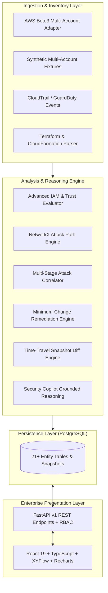

# CloudPathX V2.0 — Enterprise Architecture & Upgrade Plan

## Executive Summary

CloudPathX V2.0 upgrades the evidence-aware AWS identity analysis engine into an enterprise-grade Cloud-Native Application Protection Platform (CNAPP) with specialized modules for:
1. **CIEM (Cloud Infrastructure Entitlement Management):** Deep IAM semantics, permission boundaries, SCP/RCP layers, session policies, conditional AssumeRole, PassRole prerequisites.
2. **Attack Path Management:** NetworkX multi-hop path reasoning, confidence weighting, risk scoring (0–100), human-readable narratives, path deduplication, and comparative path exploration.
3. **Intelligent Remediation Engine:** Evidence-grounded minimum-change recommendations, interactive side-by-side policy diffs, and what-if graph recomputation verifying path removal without AWS mutation.
4. **Non-Human Identity (NHI) Security Center:** Machine identity inventory (Lambda, EC2 instance profiles, EKS, CI/CD, GitHub Actions OIDC federated roles), exposure scores, stale privilege detection, and machine trust graphs.
5. **ITDR (Identity Threat Detection & Response):** CloudTrail event sequence correlation into multi-stage attack timelines, MITRE ATT&CK cloud matrix mapping, and deduplicated incident creation.
6. **Time-Travel Security Graph:** Immutable versioned snapshots, delta comparisons (added/removed nodes, edges, attack paths, risk shifts).
7. **Infrastructure-as-Code (IaC) Security:** Pre-deployment Terraform and CloudFormation IAM scanner with projected security graph analysis and CI/CD pull request gate guidance.
8. **CloudPathX Security Copilot:** Provider-agnostic AI assistant with local heuristic/rule-based default fallback, grounded strictly in database evidence, explaining attack paths, policy rationale, and remediation.
9. **Enterprise SOC Workflows & Integrations:** Multi-account AWS inventory dashboard, case management, analyst notes, webhook/notification configuration, and executive PDF/JSON reporting.
10. **Research-Grade Evaluation:** Benchmarking suite comparing Rule-based vs. Graph-based vs. Graph+Behavioral detection across precision, recall, nDCG, and traversal latency.
11. **Enterprise UI/UX:** Refined professional cybersecurity console (Wiz/Orca/CrowdStrike inspired), dark/light theme support, tabbed modules, structured Evidence Drawer replacing raw JSON, and interactive XYFlow canvas.

---

## Technical Audit: Baseline vs. V2.0 Target

| Module | V1.0 Baseline Status | V2.0 Target State | Priority |
|---|---|---|---|
| **IAM Policy Analysis** | Allow/Deny, basic conditions, wildcards | Full boundary, SCP/RCP, session policy, PassRole prerequisites, condition operators | CRITICAL |
| **Attack Graph Engine** | Basic BFS reachability, 4 demo paths | Risk-weighted multi-hop search, path deduplication, confidence tiers, narrative explanations | CRITICAL |
| **Attack Graph UI** | XYFlow canvas, raw JSON drawer | Categorized nodes/edges, rich Evidence Drawer, path summary cards, path comparison tool | CRITICAL |
| **Remediation Engine** | Manual policy replacement recompute | Automated minimum-change suggestions, policy diff viewer, regression warnings | CRITICAL |
| **Non-Human Identities** | Filtered identity list | Dedicated NHI Security Center, OIDC federation analysis, machine risk ranking | HIGH |
| **Threat Correlation** | Single-event rule matching | Multi-stage attack chain correlation, timeline reconstruction, MITRE ATT&CK cloud mapping | HIGH |
| **Time-Travel Graph** | Single scan view | Historical snapshot comparison, edge/node deltas, risk drift timeline | HIGH |
| **IaC Security** | Not implemented | Terraform & CloudFormation IAM scanner, projected risk graph | HIGH |
| **AI Security Copilot** | Not implemented | Evidence-grounded assistant, local heuristic fallback, zero credential requirement | MEDIUM-HIGH |
| **SOC Operations & Reports** | Simple incident/finding status | SLA tracking, webhook notifications, executive PDF/JSON security reports | MEDIUM-HIGH |
| **AWS Multi-Account** | Single account scan adapter | Multi-account dashboard, coverage metrics, credential safety checks | HIGH |
| **Research Evaluation** | CLI script (`scripts/evaluate.py`) | Interactive Evaluation Dashboard, reproducible multi-scale benchmarks, nDCG | HIGH |

---

## Architecture Blueprint

---

## Detailed Milestone Execution Plan

### Milestone 1 — Attack Path Intelligence & IAM Engine Upgrade
- Enhance `backend/app/engine.py` with:
  - Complex AssumeRole condition validation (e.g. `sts:ExternalId`, MFA, source IP).
  - Explicit `iam:PassRole` prerequisite checking (requiring associated service actions like `ec2:RunInstances` or `lambda:CreateFunction`).
  - Cross-account OIDC federated trust verification (e.g. GitHub Actions `token.actions.githubusercontent.com:sub`).
  - Narrative generation explaining why paths exist and their exact prerequisites.
  - Risk-weighted path deduplication and confidence scoring.

### Milestone 2 — Enterprise Attack Graph User Interface & Evidence Drawer
- Refactor frontend graph components in `frontend/src/App.tsx`:
  - Distinct node visuals: IAM Users, IAM Roles, Service Roles, Lambdas, EC2, S3, Accounts, External Principals.
  - Distinct edge styles: Confirmed, Conditional, Potential, AssumeRole, HasPolicy.
  - Replace raw JSON drawer with structured **Evidence Drawer**:
    - Summary & Risk Score
    - Effective Policy Statements
    - Trust Relationships & Conditions
    - Attack Path Context
    - Collapsible Syntax-Highlighted Raw JSON with Copy button.
  - Selected Path Header with readable names (e.g., `Developer -> Deployment -> Payments-Worker -> Finance S3`).
  - Path comparison modal comparing two attack vectors.

### Milestone 3 — Intelligent Remediation Engine & Policy Diff
- Add automated remediation recommendations in `backend/app/engine.py`:
  - `recommend_remediations()`: calculates minimum-privilege changes (e.g. scoping `s3:*` to `s3:GetObject` or adding condition).
  - Return side-by-side policy diff metadata.
  - Frontend side-by-side diff viewer showing Original vs. Proposed with line highlights.
  - Before/after simulation displaying removed paths, remaining paths, and potential regression warnings.

### Milestone 4 — Non-Human Identity (NHI) Center
- Expand identity categorization:
  - Service roles, Lambda execution roles, EC2 instance roles, CI/CD pipelines, GitHub Actions OIDC roles.
  - Stale / unused permission indicators.
  - Machine trust relationship graph and exposure rankings.
  - Dedicated NHI dashboard view with filtering by workload type.

### Milestone 5 — Cloud Threat Detection & Multi-Stage Attack Correlation
- Multi-stage sequence correlator in `backend/app/engine.py`:
  - Detect sequences: e.g. AccessDenied -> IAM Policy Update -> Role Assumption -> Sensitive S3 Access.
  - Incident timeline view with timestamp, identity, event, MITRE ATT&CK technique (e.g. T1078, T1098, T1548).
  - Automated incident generation based on correlated sequences.

### Milestone 6 — Time-Travel Security Graph
- Snapshot storage and comparison engine:
  - Endpoint `/api/v1/snapshots` and `/api/v1/snapshots/compare`.
  - Compare two scans: Added nodes, removed nodes, altered edges, added attack paths, removed attack paths, net risk delta.
  - Interactive timeline UI for historical comparison.

### Milestone 7 — Infrastructure-as-Code (IaC) Security Module
- IaC scanner for Terraform JSON plans and AWS CloudFormation templates:
  - Detect overprivileged IAM roles, wildcard actions, cross-account trusts, and missing boundaries.
  - Project hypothetical attack paths into a preview graph.
  - Endpoint `/api/v1/iac/scan`.
  - Frontend IaC Security view with upload and sample templates.

### Milestone 8 — CloudPathX Security Copilot
- AI assistant service in `backend/app/copilot.py`:
  - Provider-agnostic abstraction (supports OpenAI/Anthropic/Gemini API keys if provided via environment, but has an evidence-grounded deterministic local fallback).
  - Grounded answers: Cites exact identity IDs, policy statements, risk scores, and event IDs.
  - Endpoint `/api/v1/copilot/query`.
  - Clean chat UI with quick security prompts.

### Milestone 9 — Enterprise SOC Workflows, Reporting & Dark Mode
- Dark mode toggle with persistent state.
- Webhook notification simulator for high-severity alerts.
- Executive PDF/JSON report generation with executive summary and remediation impact.
- Case management enhancements (assignee, resolution, SLA flags).

### Milestone 10 — Research Evaluation Suite & Verification
- Interactive Research & Evaluation Dashboard in UI (`/evaluation`):
  - Displays comparative metrics: Rule-based vs. Graph-based vs. Graph+Events.
  - Precision, Recall, F1, nDCG, analysis latency.
  - Reproducible benchmark trigger.

---

## Verification & Acceptance Criteria
- 100% of backend tests pass (`pytest tests/ -v`).
- 100% of frontend Playwright E2E tests pass (`npx playwright test`).
- Type checking (`tsc --noEmit` and `mypy`) passes with zero errors.
- Linting (`ruff check`) passes with zero errors.
- Full Docker Compose stack starts healthy (`docker compose up -d`).
- Verified commits pushed to GitHub repository `origin/feature/v2-enterprise-cnapp` and `origin/main`.
